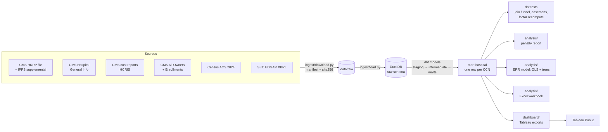

# What Medicare's readmission penalty costs hospitals, in dollars

[](https://github.com/khus-hi/hrrp-penalties/actions/workflows/ci.yml)

**Problem:** CMS publishes each hospital's HRRP payment cut as a factor like 0.9950, never as dollars. So quality and finance teams can't easily see what readmissions actually cost them, which conditions drive the cost, or how much it matters to a hospital chain.

**Approach:** I rebuilt CMS's penalty formula from public data, applied it to each hospital's Medicare payments, and followed the dollars up to conditions, states and the four public hospital chains. Everything comes from live government and SEC data: no Kaggle, no synthetic numbers.


<!-- Screenshot placeholder: save a screenshot of the "1. National" dashboard as docs/figures/dashboard.png -->

## Key findings (FY2026)

1. **HRRP will cut an estimated $315.6M from hospital payments, and pneumonia and heart failure drive more than half of it.** 2,302 of the 2,937 hospitals with a CMS factor (78.4%) are penalized. Pneumonia is 32.7% of the dollars and heart failure 22.9%. Massachusetts has the highest rate of any state, at 0.75% of Medicare base payments. My recomputed factor matches CMS's published factor for all 2,945 hospitals in its file. ([penalty report](docs/penalty_report.md))
2. **Patient social risk explains most of what *can* be explained, but that isn't much.** Hospital and community traits explain only 6.9% of the variation in readmission ratios. Dual-eligible share alone explains 4.5%: each 10 points adds 0.79% to readmissions versus expected (95% CI 0.63% to 0.94%). Teaching status and county age show no association. ([model findings](docs/err_model_findings.md))
3. **For the big public chains the penalty is small next to profits, and a care-transitions program doesn't pay for itself on the penalty alone.** HCA ($26.1M), Tenet ($4.9M), CHS ($4.4M) and UHS ($3.0M) lose 0.14% to 0.30% of FY2025 operating income. At a published cost of about $248 per patient, enrolling every eligible HCA patient would cost $12.1M a year to avoid $4.7M of penalty, so the program has to target high-risk patients to break even. ([Excel workbook](analysis/output/hrrp_chain_workbook.xlsx), [formula guide](docs/workbook_guide.md))

## Architecture



Joins: CCN (6-character string) links the CMS files. Ownership goes through Enrollment ID to CCN, then a seed table of owner names to the chain's SEC CIK. Each hospital's county FIPS comes from a name match, with a ZIP-to-county fallback. Every join reports how many hospitals it drops ([data quality report](docs/data_quality_report.md)).

## Tech stack

- **Python:** pandas, requests, statsmodels (robust and clustered OLS), scikit-learn (gradient-boosted trees, permutation importance), matplotlib
- **SQL:** DuckDB, with layered models and data-quality assertions
- **Excel:** openpyxl. Every number is a live formula, with editable scenario and ROI inputs
- **Tableau Public:** five linked dashboards with LOD expressions, parameters and filter actions
- All free. API keys live in a git-ignored `.env`

## Data sources

| Source | Used for |
|---|---|
| [CMS FY2026 HRRP hospital file](https://data.cms.gov/provider-data/dataset/9n3s-kdb3) | Excess readmission ratios, discharges, expected rates |
| [FY2026 HRRP supplemental file](https://www.cms.gov/files/zip/fy2026-hospital-readmissions-reduction-program-supplemental-data-file.zip) and [Table 15](https://www.cms.gov/files/zip/fy-2026-hospital-readmissions-reduction-program-payment-adjustment-factors.zip) | Payment adjustment factors, peer medians, DRG payment ratios |
| [CMS Hospital General Information](https://data.cms.gov/provider-data/dataset/xubh-q36u) | Ownership, type, star rating, county |
| [CMS hospital cost reports (HCRIS)](https://data.cms.gov/provider-compliance/cost-reports/hospital-provider-cost-report) | Medicare base DRG payments, beds, teaching, DSH % |
| [CMS Hospital All Owners](https://data.cms.gov/provider-characteristics/hospitals-and-other-facilities/hospital-all-owners) and [Enrollments](https://data.cms.gov/provider-characteristics/hospitals-and-other-facilities/hospital-enrollments) | Parent system |
| [Census ACS 2024 5-year](https://api.census.gov/data/2024/acs/acs5) | County income and share aged 65+ |
| [SEC EDGAR companyfacts](https://www.sec.gov/search-filings/edgar-application-programming-interfaces) | Chains' revenue, operating income, net income |

Endpoints, join keys and caveats are in [docs/data_sources.md](docs/data_sources.md). The penalty method and assumptions are in [docs/penalty_method.md](docs/penalty_method.md).

## How to run it

```bash
python -m venv .venv && source .venv/bin/activate
pip install -e ".[dev]"           # installs the project and its dependencies (pyproject.toml)
cp .env.example .env               # add SEC_USER_AGENT and a free CENSUS_API_KEY
python -m ingest.download && python -m ingest.load && python -m models.build
python -m analysis.penalty_report  # docs/penalty_report.md + analysis/output/*.csv
python -m analysis.err_model       # docs/err_model_report.md + docs/figures/
python -m analysis.build_workbook  # analysis/output/hrrp_chain_workbook.xlsx
python -m dashboard.export_tableau # CSVs for Tableau (docs/tableau_build_guide.md)
python -m analysis.open_checks     # coverage checks (docs/open_checks_report.md)
make test                          # unit tests, no downloads needed
```

Or run the main steps with `make all` (`make help` lists every target).

## Automated checks and refresh

- **CI** ([ci.yml](.github/workflows/ci.yml)) runs on every push and pull request: ruff, pytest, then `dbt build` against a small DuckDB made from about 50 real hospitals checked into [tests/fixtures/](tests/fixtures/README.md), so it never calls CMS, SEC or Census.
- **Monthly refresh** ([refresh.yml](.github/workflows/refresh.yml)) re-downloads every source, rebuilds, reruns the analysis and opens a pull request if any output changed. It stops if a source file changed and its columns changed too ([schema check](ingest/schema_check.py)).
- Setup steps, including the two repository secrets, are in [docs/automation.md](docs/automation.md).

## Limits, and what I'd do next

- **The dollars are estimates.** They use 2024-25 cost-report payments rather than FY2026 claims, and CMS publishes no FY2026 dollar total to check against. Next: cross-check the payment base against the CMS IPPS Impact File.
- **Chain hospital counts differ from the 10-Ks.** Tenet maps to 61 hospitals in CMS ownership records against 50 in its 10-K, and CHS to 50 against 69 ([open checks](docs/open_checks_report.md)). Next: reconcile hospital by hospital against the 10-K facility lists.
- **The model is cross-sectional.** Next: track the same hospitals across FY2023 to FY2027 to see whether penalized hospitals actually improve, which is the program's real test.
