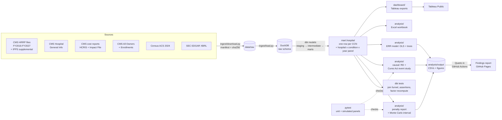

# Does Medicare's readmission penalty work, and what does it cost?

[](https://github.com/khus-hi/hrrp-penalties/actions/workflows/ci.yml)
[](https://khus-hi.github.io/hrrp-penalties/)

**Being penalized does not detectably lower a hospital's readmissions.** Using a regression discontinuity at CMS's penalty line, hospitals just over their peer-group median (penalized) have readmissions **+0.03% of expected** three years later compared with hospitals just under it (**robust 95% CI -0.26% to +0.36%**; 71,674 hospital-condition-years, 3,002 hospitals, FY2019-FY2024). Any effect at the line is smaller than about a third of a percent. Even so, the program will cut an estimated **$315.6M** from hospital payments in FY2026.

📄 **Read the findings report: [khus-hi.github.io/hrrp-penalties](https://khus-hi.github.io/hrrp-penalties/)** (question, data, methods, results, threats to validity, and what to do with it).

<!-- Dashboard screenshot: save a screenshot of the "1. National" Tableau dashboard as docs/figures/dashboard.png,
     then replace this comment with:

-->

**Problem:** Medicare's Hospital Readmissions Reduction Program (HRRP) cuts up to 3% of a hospital's base inpatient payments when readmissions for six conditions are worse than expected. CMS publishes each cut as a factor like 0.9950, never in dollars, and never says whether the cut changes what hospitals do. Everything here comes from live CMS, Census and SEC data: no Kaggle, no synthetic numbers.

## Key findings

1. **Does the penalty reduce readmissions? No detectable effect.**
   - *Regression discontinuity (headline):* +0.03% of expected (95% CI -0.26% to +0.36%). No condition on its own is different from zero. The checks pass: no bunching under the line (density test p = 0.92), no jump in the pre-period ERR (p = 0.41), and placebo cutoffs, a donut, half and double bandwidths and a fuzzy RD are all null. ([RD report](docs/rd_report.md))
   - *Event study of the 2019 Cures Act peer-group reform (second design):* it isn't causal, because the pre-trend test fails (p = 0.016). The version that controls for mean reversion is +0.11% in FY2022 (95% CI -0.02% to +0.24%). That's close to zero and consistent with the RD. The rule is coded right: it reproduces CMS's FY2019 factor for all 3,173 hospitals. ([event study report](docs/did_report.md))
2. **What does it cost? $315.6M in FY2026, with a 90% interval of $316.1M to $337.3M across all penalized hospitals.** (The interval sits slightly above the point estimate because it also estimates a payment base for 23 penalized hospitals that have no usable cost report, which the point estimate counts as $0. Over the same hospitals the interval is $314.6M to $335.7M.) 2,302 of the 2,937 hospitals with a CMS factor (78.4%) are penalized. Pneumonia (32.7%) and heart failure (22.9%) are more than half of the dollars. My recomputed factor matches CMS's for all 2,945 hospitals in its file. A Monte Carlo simulation over two independent payment bases (cost reports and the CMS Impact File) says the point estimate is more likely low than high. ([penalty report](docs/penalty_report.md), [uncertainty](docs/penalty_uncertainty.md))
   - **The four public chains lose $38.4M together**: HCA $26.1M, Tenet $4.9M, CHS $4.4M and UHS $3.0M. That's 0.14% to 0.30% of FY2025 operating income. At a published cost of about $248 per patient, enrolling every eligible HCA patient in a care-transitions program would cost $12.1M a year to avoid $4.7M of penalty, so a program only breaks even if it targets high-risk patients. ([Excel workbook](analysis/output/hrrp_chain_workbook.xlsx), [formula guide](docs/workbook_guide.md))
3. **What drives readmission ratios? Mostly not the hospital's structure.** Hospital and county traits explain only 6.9% of the variation. Dual-eligible share explains most of what can be explained: each 10 points goes with readmissions 0.79% of expected higher (95% CI 0.63% to 0.94%). For-profit hospitals are 1.75% higher. Teaching status and county age show no association. ([model findings](docs/err_model_findings.md))

## Outputs

| Output | What it's for | Where |
|---|---|---|
| **Findings report** (Quarto → HTML) | The written story: question, methods, results with figures, threats to validity, recommendations | [GitHub Pages](https://khus-hi.github.io/hrrp-penalties/) · source [report/hrrp.qmd](report/hrrp.qmd) |
| **Tableau Public dashboards** | Explore any hospital, state or condition: five linked dashboards | [dashboard/](dashboard/) · [build guide](docs/tableau_build_guide.md) |
| **Excel workbook** | Chain finance: penalty vs 10-K income, scenarios, care-transitions ROI, all live formulas | [hrrp_chain_workbook.xlsx](analysis/output/hrrp_chain_workbook.xlsx) · [guide](docs/workbook_guide.md) |
| **Causal analysis** | Regression discontinuity and Cures Act event study | [rd_report.md](docs/rd_report.md) · [did_report.md](docs/did_report.md) |
| **Method reports** | Penalty dollars, uncertainty, ERR model, data quality | [docs/](docs/) |
| **Tables** | Every number above as CSV | [analysis/output/](analysis/output/) |

## For analysts / For data scientists

**For analysts** (business, healthcare, finance): start with the [findings report](https://khus-hi.github.io/hrrp-penalties/). Then look up one hospital in the Tableau dashboards or in [hospital_penalty.csv](analysis/output/hospital_penalty.csv), which has each hospital's dollars and condition split. For the chain finance view, open the [Excel workbook](analysis/output/hrrp_chain_workbook.xlsx) and change the yellow input cells. The [penalty report](docs/penalty_report.md) has the national, state and ownership tables.

**For data scientists**: the causal designs are in [hrrp/causal/rd.py](hrrp/causal/rd.py) and [hrrp/causal/did.py](hrrp/causal/did.py). Their reports ([RD](docs/rd_report.md), [event study](docs/did_report.md)) list every robustness check. The Monte Carlo is in [hrrp/uncertainty.py](hrrp/uncertainty.py), and the cross-sectional model is in [analysis/err_model.py](analysis/err_model.py), with diagnostics in [err_model_report.md](docs/err_model_report.md). Tests are in [tests/](tests/), and that folder includes simulated panels with a planted effect, to check that the estimators recover it. The data pipeline is in [dbt/](dbt/), with the data tests summarised in the [data quality report](docs/data_quality_report.md).

**Skills shown:** SQL · dbt · pytest · regression discontinuity · difference-in-differences · robust inference · Monte Carlo · CI/CD

## Architecture



Joins: CCN (6-character string) links the CMS files. Ownership goes through Enrollment ID to CCN, then a seed table of owner names to the chain's SEC CIK. Each hospital's county FIPS comes from a name match, with a ZIP-to-county fallback. Every join reports how many hospitals it drops ([data quality report](docs/data_quality_report.md)).

## Tech stack

- **SQL and dbt:** DuckDB with dbt-duckdb models (staging, intermediate, marts), generic and singular data tests, and seeds for the hand-built crosswalks
- **Python:** pandas, statsmodels (robust and clustered OLS), scikit-learn (gradient-boosted trees, permutation importance), rdrobust and rddensity (regression discontinuity), pyfixest (fixed-effects event study), matplotlib
- **Testing and CI/CD:** pytest and ruff, plus `dbt build` on a 50-hospital fixture in GitHub Actions. A monthly data-refresh workflow and a Quarto render-and-publish workflow to GitHub Pages
- **Reporting:** Quarto (HTML report), Tableau Public (five linked dashboards with LOD expressions, parameters and filter actions), Excel via openpyxl (every number a live formula)
- All free. API keys live in a git-ignored `.env`

## Data sources

| Source | Used for |
|---|---|
| [CMS FY2026 HRRP hospital file](https://data.cms.gov/provider-data/dataset/9n3s-kdb3) | Excess readmission ratios, discharges, expected rates |
| [FY2026 HRRP supplemental file](https://www.cms.gov/files/zip/fy2026-hospital-readmissions-reduction-program-supplemental-data-file.zip) and [Table 15](https://www.cms.gov/files/zip/fy-2026-hospital-readmissions-reduction-program-payment-adjustment-factors.zip) | Payment adjustment factors, peer medians, DRG payment ratios |
| HRRP supplemental files FY2016-FY2027 (links in [ingest/config.py](ingest/config.py)) | The multi-year panel behind the RD and the event study |
| [CMS Hospital General Information](https://data.cms.gov/provider-data/dataset/xubh-q36u) | Ownership, type, star rating, county |
| [CMS hospital cost reports (HCRIS)](https://data.cms.gov/provider-compliance/cost-reports/hospital-provider-cost-report) | Medicare base DRG payments, beds, teaching, DSH % |
| CMS FY2026 IPPS Impact File and final rule | Second payment base for the uncertainty interval |
| [CMS Hospital All Owners](https://data.cms.gov/provider-characteristics/hospitals-and-other-facilities/hospital-all-owners) and [Enrollments](https://data.cms.gov/provider-characteristics/hospitals-and-other-facilities/hospital-enrollments) | Parent system |
| [Census ACS 2024 5-year](https://api.census.gov/data/2024/acs/acs5) | County income and share aged 65+ |
| [SEC EDGAR companyfacts](https://www.sec.gov/search-filings/edgar-application-programming-interfaces) | Chains' revenue, operating income, net income |

Endpoints, join keys and caveats are in [docs/data_sources.md](docs/data_sources.md). The penalty method and assumptions are in [docs/penalty_method.md](docs/penalty_method.md).

## How to run it

```bash
python -m venv .venv && source .venv/bin/activate
pip install -e ".[dev]"
cp .env.example .env
make ingest
make build
make analysis
make rd
make did
make workbook
make tableau
make report
make test
```

Add `SEC_USER_AGENT` and a free `CENSUS_API_KEY` to `.env` before `make ingest`. `make report` needs [Quarto](https://quarto.org/docs/get-started/) (free) and renders `report/_site/hrrp.html` from the committed outputs. `make help` lists every target.

## Automated checks and publishing

- **CI** ([ci.yml](.github/workflows/ci.yml)) runs on every push and pull request: ruff, pytest, then `dbt build` against a small DuckDB made from about 50 real hospitals checked into [tests/fixtures/](tests/fixtures/README.md), so it never calls CMS, SEC or Census.
- **Report** ([report.yml](.github/workflows/report.yml)) renders [report/hrrp.qmd](report/hrrp.qmd) with Quarto and publishes it to GitHub Pages on every push to `main` that changes the report or the outputs. It reads the committed CSVs and figures, not the database, so it needs no data download and no secrets.
- **Monthly refresh** ([refresh.yml](.github/workflows/refresh.yml)) re-downloads every source, rebuilds, reruns the analysis and opens a pull request if any output changed. It stops if a source file changed and its columns changed too ([schema check](ingest/schema_check.py)).
- Setup steps, including the two repository secrets, are in [docs/automation.md](docs/automation.md).

## Limits, and what I'd do next

- **The RD answers a local question.** It's the effect of being just over the median, where the formula charges almost nothing. Hospitals far above the median pay more and might respond more. Next: a design that uses the size of the penalty, such as the kink in the formula at the 3% cap.
- **The dollars are estimates.** They use 2024-25 cost-report payments rather than FY2026 claims, and CMS publishes no FY2026 dollar total. The Monte Carlo interval and the Impact File cross-check bound this.
- **Chain hospital counts differ from the 10-Ks.** Tenet maps to 61 hospitals in CMS ownership records against 50 in its 10-K, and CHS to 50 against 69 ([open checks](docs/open_checks_report.md)). Next: reconcile hospital by hospital against the 10-K facility lists.
