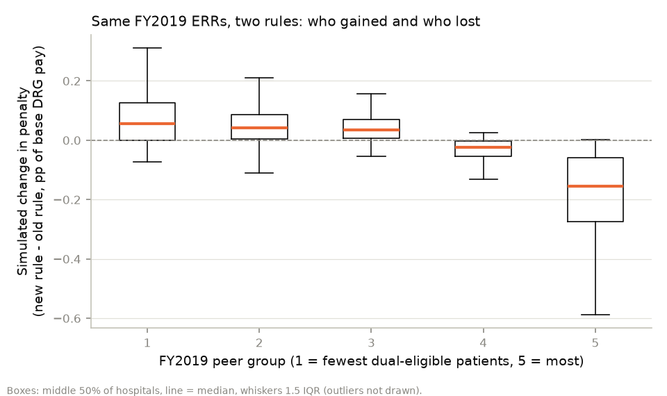
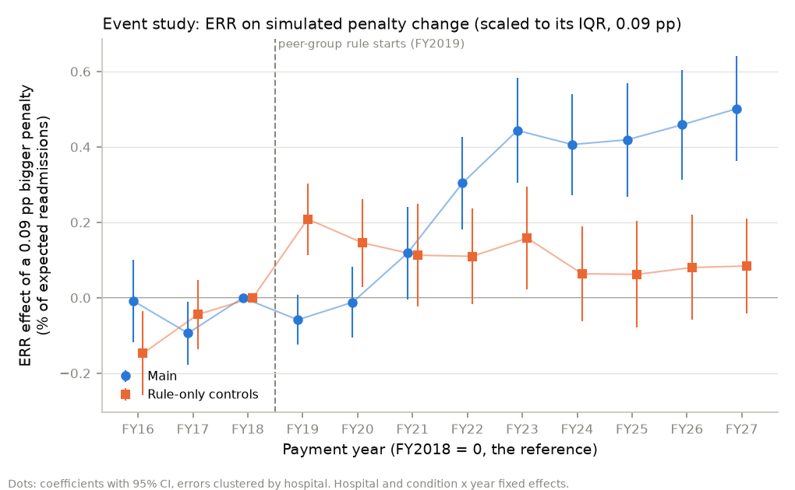
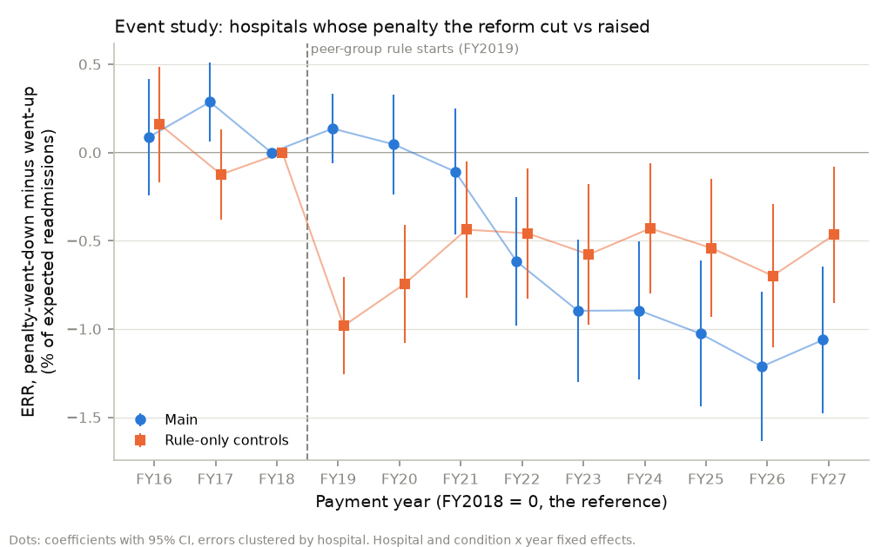

# Did the 2019 peer-group reform change readmissions? (Cures Act event study)

_Generated 2026-11-04 01:56 UTC by `python -m analysis.did_report` from `mart.fct_hospital_condition_year` (payment years FY2016-FY2027). Do not edit by hand; every number below comes from that run._

## Bottom line

- **Main specification:** In FY2022, a reform-driven penalty increase of 0.09 percentage points (the middle 50% range of the simulated change) is followed by readmissions 0.30% of expected higher (95% CI +0.18% to +0.43%), relative to FY2018. The 95% interval excludes zero. Pre-trend test on the leads: p = 0.016.

- **Rule-only specification:** In FY2022, a reform-driven penalty increase of 0.09 percentage points (the middle 50% range of the simulated change) is followed by readmissions 0.11% of expected higher (95% CI -0.02% to +0.24%), relative to FY2018. The 95% interval includes zero, so the data can't tell this apart from no effect. Pre-trend test on the leads: p = 0.016.

The rule-only specification fails the pre-trend test, so neither estimate should be read as causal.

- **Units:** dpen is the simulated change in a hospital's penalty, in percentage points of its base DRG payments (new rule minus old rule on the same FY2019 data). Effects are shown for a 0.09 pp change, the distance from the 25th to the 75th percentile of dpen. ERR = predicted / expected readmissions, so an ERR change of -0.01 is 1% of expected fewer readmissions.
- **Which years count as post:** a payment year's ERR comes from a 3-year window. Only windows that start after the Cures Act was signed (13 December 2016) can show a response to it; FY2019-FY2021 windows straddle it. The headline uses the post years whose window also ends before 2020 (FY2022), because COVID-era windows may hit safety-net hospitals (the reform's winners) differently, which the condition x year fixed effects can't absorb. The all-years average is in the table.

## 1. Treatment intensity: two rules, same FY2019 data

For each hospital in CMS's FY2019 supplemental file, both rules are applied to its FY2019 ERRs, DRG payment ratios and eligible discharges (only conditions with 25+ count), with the 3% cap:

- old rule (FY2013-FY2018): `min(3%, sum ratio_c x max(ERR_c - 1, 0))`
- new rule (FY2019 on): `min(3%, NM x sum ratio_c x max(ERR_c - peer median_c, 0))`

Neutrality modifier NM = **0.9534** (CMS FY2019 supplemental file). Backed out of CMS's published FY2019 adjustment factors as (1 - factor) / sum of excess terms, it is 0.9535 (median over 2,171 hospitals with a reduction of 0.1% to 3%; 5th-95th percentile 0.9393-0.9679, the spread coming from CMS rounding factors to 4 decimals).

**Check that the new rule is coded right:** recomputing FY2019 adjustment factors from these inputs matches CMS's published factor within 0.0001 (CMS's rounding) for **3,173 of 3,173** hospitals, and within 0.001 for 3,173 (largest gap 0.0000).

FY2019 file: 3,173 hospitals, 3,172 with DRG payment ratios, 3,173 with a peer group. Hospitals with at least one condition that counts (25+ cases): **3,062**. Penalty went down: 1,139; up: 1,496; unchanged (no penalty under either rule, or exactly equal): 427.

dpen percentiles (pp): p10 -0.157, p25 -0.035, p50 +0.000, p75 +0.057, p90 +0.110.

By FY2019 peer group (means; penalties in % of base DRG payments):

| peer_group | hospitals | dual_share_mean | old_rule_pct | new_rule_pct | dpen_mean_pp | share_down | share_up | share_unchanged |
|---|---|---|---|---|---|---|---|---|
| 1 | 584 | 0.09449 | 0.5693 | 0.6533 | 0.08405 | 0.01027 | 0.7295 | 0.2603 |
| 2 | 620 | 0.1608 | 0.5713 | 0.6223 | 0.05099 | 0.1065 | 0.7935 | 0.1 |
| 3 | 622 | 0.207 | 0.5539 | 0.5977 | 0.0438 | 0.04984 | 0.8199 | 0.1302 |
| 4 | 629 | 0.2668 | 0.6323 | 0.5973 | -0.03508 | 0.7758 | 0.1065 | 0.1176 |
| 5 | 607 | 0.4492 | 0.6797 | 0.5012 | -0.1785 | 0.9028 | 0.001647 | 0.09555 |

## 2. Event study

`ERR_ict = sum_k b_k 1{year = k} x dpen_i + hospital_i + condition x year_ct + e_ict`, FY2018 omitted, pyfixest `feols`, errors clustered by hospital. Rows are hospital x condition x payment year with an ERR, for hospitals with a dpen (173,128 rows). Leads (FY2016, FY2017) test for pre-trends; FY2019 on traces the response. A negative coefficient means a bigger reform-driven penalty went with lower readmissions.

### Why two specifications

dpen is computed from FY2019 ERRs, and the FY2017-FY2021 windows share discharges with FY2019's (table below). A hospital with an unlucky FY2019 has a higher ERR in FY2019 by construction and a lower one later (mean reversion), and its dpen depends on that luck. So the FY2019 coefficient is mechanical, not an effect, and neighbouring years can be too. The **rule-only** specification adds year-specific slopes in the hospital's own FY2019 ERR for the condition and in its old-rule penalty. What is left to move dpen is the peer-group median, i.e. the rule.

| fy | window | months_shared_with_fy2019 | window_vs_cures_act | includes_2020_or_later |
|---|---|---|---|---|
| 2016 | 2011-07..2014-06 | 0 | before the Act | False |
| 2017 | 2012-07..2015-06 | 12 | before the Act | False |
| 2018 | 2013-07..2016-06 | 24 | before the Act | False |
| 2019 | 2014-07..2017-06 | 36 | straddles the Act | False |
| 2020 | 2015-07..2018-06 | 24 | straddles the Act | False |
| 2021 | 2016-07..2019-06 | 12 | straddles the Act | False |
| 2022 | 2017-07..2019-12 | 0 | after the Act | False |
| 2023 | 2018-07..2021-06 | 0 | after the Act | True |
| 2024 | 2019-07..2022-06 | 0 | after the Act | True |
| 2025 | 2020-07..2023-06 | 0 | after the Act | True |
| 2026 | 2021-07..2024-06 | 0 | after the Act | True |
| 2027 | 2023-07..2025-06 | 0 | after the Act | True |

### Coefficients

Effect of a 0.09 pp bigger simulated penalty on ERR, as % of expected readmissions (95% CI):

| FY | Main | Rule-only | Hospital x condition FE instead of hospital FE | Drop hospitals that changed peer group after FY2019 |
|---|---|---|---|---|
| FY2016 | -0.01% (-0.12% to +0.10%) | -0.15% (-0.26% to -0.04%) | +0.06% (-0.05% to +0.17%) | -0.02% (-0.15% to +0.12%) |
| FY2017 | -0.09% (-0.18% to -0.01%) | -0.04% (-0.14% to +0.05%) | -0.03% (-0.12% to +0.05%) | -0.11% (-0.21% to -0.01%) |
| FY2018 | 0 (reference) | 0 (reference) | 0 (reference) | 0 (reference) |
| FY2019 | -0.06% (-0.12% to +0.01%) | +0.21% (+0.11% to +0.30%) | -0.06% (-0.13% to +0.01%) | -0.05% (-0.13% to +0.03%) |
| FY2020 | -0.01% (-0.11% to +0.08%) | +0.15% (+0.03% to +0.26%) | -0.01% (-0.11% to +0.08%) | -0.02% (-0.13% to +0.10%) |
| FY2021 | +0.12% (-0.00% to +0.24%) | +0.11% (-0.02% to +0.25%) | +0.12% (-0.00% to +0.24%) | +0.14% (-0.02% to +0.29%) |
| FY2022 | +0.30% (+0.18% to +0.43%) | +0.11% (-0.02% to +0.24%) | +0.31% (+0.19% to +0.43%) | +0.34% (+0.19% to +0.50%) |
| FY2023 | +0.44% (+0.30% to +0.58%) | +0.16% (+0.02% to +0.30%) | +0.36% (+0.22% to +0.50%) | +0.53% (+0.36% to +0.71%) |
| FY2024 | +0.41% (+0.27% to +0.54%) | +0.06% (-0.06% to +0.19%) | +0.42% (+0.28% to +0.55%) | +0.52% (+0.36% to +0.69%) |
| FY2025 | +0.42% (+0.27% to +0.57%) | +0.06% (-0.08% to +0.20%) | +0.43% (+0.28% to +0.58%) | +0.54% (+0.35% to +0.72%) |
| FY2026 | +0.46% (+0.31% to +0.60%) | +0.08% (-0.06% to +0.22%) | +0.47% (+0.32% to +0.62%) | +0.56% (+0.38% to +0.74%) |
| FY2027 | +0.50% (+0.36% to +0.64%) | +0.08% (-0.04% to +0.21%) | +0.52% (+0.38% to +0.66%) | +0.62% (+0.44% to +0.79%) |

### Summary and checks

Pre-trend test: joint F-test that the FY2016 and FY2017 coefficients are 0 (cluster-robust). Post averages: mean of the yearly coefficients (continuous rows scaled to 0.09 pp; binary rows are the down-minus-up gap in ERR). In the binary rows a **positive** number is the expected sign: hospitals whose penalty fell would ease off and readmit more.

| Specification | Pre-trend test (FY2016, FY2017 = 0) | Pre-COVID post (FY2022) | All post years (FY2022-FY2027) | Rows | Hospitals |
|---|---|---|---|---|---|
| Main: dpen x year, hospital + condition x year FE | F = 4.11, p = 0.016 | +0.30% (+0.18% to +0.43%), p = 0.000 | +0.42% (+0.30% to +0.54%), p = 0.000 | 173,128 | 3,062 |
| Rule-only: + year-specific slopes in FY2019 ERR and old-rule penalty | F = 4.16, p = 0.016 | +0.11% (-0.02% to +0.24%), p = 0.091 | +0.09% (-0.02% to +0.20%), p = 0.098 | 172,241 | 3,062 |
| Hospital x condition FE instead of hospital FE | F = 2.79, p = 0.061 | +0.31% (+0.19% to +0.43%), p = 0.000 | +0.42% (+0.30% to +0.54%), p = 0.000 | 173,048 | 3,062 |
| Drop hospitals that changed peer group after FY2019 | F = 3.34, p = 0.036 | +0.34% (+0.19% to +0.50%), p = 0.000 | +0.52% (+0.37% to +0.67%), p = 0.000 | 85,228 | 1,558 |
| Binary: penalty went down (1) vs up (0) | F = 4.72, p = 0.009 | -0.62% (-0.98% to -0.25%), p = 0.001 | -0.95% (-1.30% to -0.61%), p = 0.000 | 153,746 | 2,635 |
| Binary, rule-only controls | F = 3.29, p = 0.038 | -0.46% (-0.83% to -0.09%), p = 0.015 | -0.53% (-0.85% to -0.20%), p = 0.001 | 153,109 | 2,635 |

Hospitals that changed peer group after FY2019 (dropped in that row): **1,504** of 3,062. Peer groups are quintiles of the dual share, recomputed every year, so hospitals near a boundary move; their real exposure after FY2019 differs from the simulated one.

### Placebo: pretend the reform happened earlier

FY2016-FY2018 only (all under the old rule), dpen x 1{year >= fake year}, same fixed effects. There was no reform then, so the coefficient should be 0 (per pp of dpen, as % of expected readmissions):

| Placebo | Estimate | 95% CI | p | Rows | Hospitals |
|---|---|---|---|---|---|
| Fake reform in FY2017 (FY2016-FY2018 only) | -0.39% | -1.35% to +0.57% | 0.425 | 42,831 | 3,055 |
| Fake reform in FY2018 (FY2016-FY2018 only) | +0.59% | -0.37% to +1.56% | 0.229 | 42,831 | 3,055 |

## 3. Compared with the RD

The regression discontinuity (`docs/rd_report.md`) found that being just above the peer-group median rather than just below changes the same condition's ERR three years later by **+0.03%** of expected (robust 95% CI -0.26% to +0.36%, 71,674 rows).

The event study (rule-only) gives +0.11% for a 0.09 pp bigger penalty (95% CI -0.02% to +0.24%; it includes zero).

They answer different questions, so they can disagree without either being wrong:

- **Local vs average.** The RD is the effect for conditions right at the median, where CMS's formula charges almost nothing (the penalty grows with ERR minus the median, so just above it the money is close to 0). It measures being *flagged*. The event study averages over every hospital and is driven by how many *dollars* the rule moved: the effect of the size of the penalty, not of crossing a line.
- **Different hospitals.** The RD's information comes from hospitals near the median for some condition; the event study's from hospitals the reform moved most, which are those far from the median in peer groups 1 and 5 (lowest and highest dual share). If safety-net hospitals respond differently (fewer resources to cut readmissions), the two average over different people.
- **Condition vs hospital.** RD compares conditions within the same year; the penalty change here is hospital-wide, so a hospital-wide response (a discharge-planning program that helps every condition) shows up here but is differenced away in the RD.
- **Timing.** RD looks three payment years after one year's status. The event study follows a permanent rule change for up to eight years.
- **Assumptions.** RD needs no manipulation at the median (the density test passed); the event study needs parallel trends between hospitals the reform helped and hurt, which the lead test checks only for FY2016-FY2017, and it can be thrown off by anything else that hit safety-net hospitals after 2017 (COVID, Medicaid expansion timing).

## What it can't rule out

- Only two clean leads (FY2016, FY2017): a short pre-period gives the pre-trend test little power.
- dpen is built from FY2019 *outcomes*. The rule-only controls handle the linear part of mean reversion; a non-linear part would remain.
- The reform was public in December 2016 and CMS finalized the method in the FY2018 IPPS rule (August 2017); hospitals may have reacted at either date, or only once they saw their FY2019 report in 2018.
- Hospitals that closed or merged after FY2019 leave the panel; if that depends on dpen it biases the later years.
- Five specifications, two placebo years, many years: some coefficients will cross p < 0.05 by chance.

## Figures

### Treatment intensity by peer group

### Event study, continuous intensity

### Event study, binary (down vs up)

## Files

- `analysis/output/did_intensity.csv`: one row per hospital (old and new penalty, dpen, peer group)
- `analysis/output/did_event_study.csv`: every coefficient of every specification
- `analysis/output/did_tests.csv`: pre-trend tests, post averages, placebos
- Method: `hrrp/causal/did.py` (tests on simulated panels with a known effect in `tests/test_did.py`)
