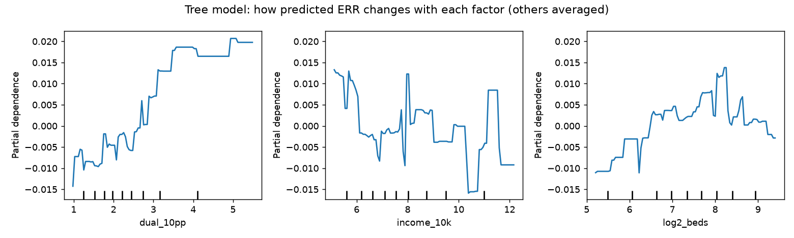
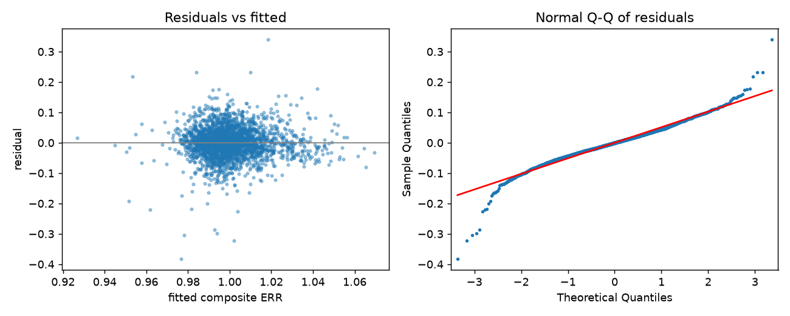

# What explains a hospital's excess readmission ratio?

_Generated by `python -m analysis.err_model` from the live data in data/hrrp.duckdb._

## Data

- Outcome: composite ERR (discharge-weighted average of the six FY2026 ERRs). Mean 1.0001, SD 0.0532.

- Hospitals with a composite ERR: 2,937. Used in the models (no missing predictors): **2,576**.

- Missing values that removed hospitals: log2_beds 10, teaching 10, ownership 0, dual_10pp 0, income_10k 44, age65_5pp 44, star_rating 328.

- Effects are shown as **% of expected readmissions** (an ERR change of 0.01 = 1%).

## Main model (OLS, HC3 robust standard errors, without star rating)

R² = 0.069, adjusted R² = 0.066, n = 2,576.

| term | coef | ci_low | ci_high | p_value |
|---|---|---|---|---|
| teaching hospital | 0.0000 | -0.0049 | 0.0049 | 0.9997 |
| For-profit (vs nonprofit) | 0.0175 | 0.0123 | 0.0227 | 0.0000 |
| Government (vs nonprofit) | 0.0006 | -0.0047 | 0.0060 | 0.8119 |
| Other (vs nonprofit) | -0.0638 | -0.1104 | -0.0173 | 0.0072 |
| Physician-owned (vs nonprofit) | -0.0211 | -0.0708 | 0.0285 | 0.4040 |
| beds (per doubling) | 0.0024 | 0.0005 | 0.0044 | 0.0129 |
| dual-eligible share (+10 pts) | 0.0079 | 0.0063 | 0.0094 | 0.0000 |
| county income (+$10k) | -0.0014 | -0.0023 | -0.0004 | 0.0056 |
| county 65+ share (+5 pts) | 0.0013 | -0.0011 | 0.0038 | 0.2866 |

### In plain English

- Holding the other factors fixed, being a teaching hospital (any residents) vs not goes with readmissions about 0.00% higher relative to expected (95% CI -0.49% to +0.49%; not distinguishable from zero).
- Holding the other factors fixed, For-profit ownership (vs nonprofit) goes with readmissions about 1.75% higher relative to expected (95% CI +1.23% to +2.27%; clearly different from zero).
- Holding the other factors fixed, Government ownership (vs nonprofit) goes with readmissions about 0.06% higher relative to expected (95% CI -0.47% to +0.60%; not distinguishable from zero).
- Holding the other factors fixed, Other ownership (vs nonprofit) goes with readmissions about 6.38% lower relative to expected (95% CI -11.04% to -1.73%; clearly different from zero).
- Holding the other factors fixed, Physician-owned ownership (vs nonprofit) goes with readmissions about 2.11% lower relative to expected (95% CI -7.08% to +2.85%; not distinguishable from zero).
- Holding the other factors fixed, twice as many beds goes with readmissions about 0.24% higher relative to expected (95% CI +0.05% to +0.44%; weak evidence).
- Holding the other factors fixed, a 10-percentage-point higher share of dual-eligible (Medicare + Medicaid) patients goes with readmissions about 0.79% higher relative to expected (95% CI +0.63% to +0.94%; clearly different from zero).
- Holding the other factors fixed, $10,000 higher county median household income goes with readmissions about 0.14% lower relative to expected (95% CI -0.23% to -0.04%; clearly different from zero).
- Holding the other factors fixed, a 5-percentage-point higher share of county residents aged 65+ goes with readmissions about 0.13% higher relative to expected (95% CI -0.11% to +0.38%; not distinguishable from zero).

### Does it hold up? (sensitivity checks)

| term | main | by-state clusters | discharge-weighted | with star |
|---|---|---|---|---|
| teaching hospital | +0.00% (p=1.000) | +0.00% (p=1.000) | -0.27% (p=0.542) | -0.09% (p=0.718) |
| For-profit (vs nonprofit) | +1.75% (p=0.000) | +1.75% (p=0.001) | +2.43% (p=0.000) | +0.84% (p=0.001) |
| Government (vs nonprofit) | +0.06% (p=0.812) | +0.06% (p=0.859) | -0.33% (p=0.465) | -0.54% (p=0.032) |
| Other (vs nonprofit) | -6.38% (p=0.007) | -6.38% (p=0.000) | -7.26% (p=0.015) | -2.52% (p=0.085) |
| Physician-owned (vs nonprofit) | -2.11% (p=0.404) | -2.11% (p=0.125) | -3.54% (p=0.178) | -1.91% (p=0.409) |
| beds (per doubling) | +0.24% (p=0.013) | +0.24% (p=0.026) | +0.02% (p=0.943) | +0.16% (p=0.088) |
| dual-eligible share (+10 pts) | +0.79% (p=0.000) | +0.79% (p=0.000) | +1.04% (p=0.000) | +0.30% (p=0.000) |
| county income (+$10k) | -0.14% (p=0.006) | -0.14% (p=0.097) | -0.23% (p=0.007) | +0.09% (p=0.046) |
| county 65+ share (+5 pts) | +0.13% (p=0.287) | +0.13% (p=0.600) | +0.34% (p=0.144) | -0.06% (p=0.616) |

- Using Medicare **DSH %** instead of the dual-eligible share: +0.55% per 10 points (p=0.000, n=2,267).

- Adding **star rating**: -1.97% per star (p=0.000). Read with care, because star ratings include readmission measures, so part of this is the outcome explaining itself.

## How much of the variation does social risk explain?

- Social risk alone (dual share, county income, county 65+ share): R² = **0.048**. Dual-eligible share by itself: R² = 0.045.

- Shapley split of the main model's R² (0.069): social risk 0.046 (66%), hospital structure 0.024 (34%).

- With star rating added (R² 0.195): social risk 0.027, hospital structure 0.016, star rating 0.152.

- So roughly 93% of the variation in composite ERR is **not** explained by any of these factors.

## Is the linear model missing nonlinearity?

- 5-fold cross-validated R²: linear 0.058 (±0.015), gradient-boosted tree 0.070 (±0.021). If the tree isn't clearly better, the linear model is a fair summary.

Permutation importance on a 25% held-out set (drop in R² when a feature is shuffled):

| feature | importance_r2_drop |
|---|---|
| dual_10pp | 0.0767 |
| income_10k | 0.0457 |
| log2_beds | 0.0442 |
| ownership_For-profit | 0.0295 |
| age65_5pp | 0.0152 |
| ownership_Nonprofit | 0.0017 |
| ownership_Other | 0.0000 |
| ownership_Physician-owned | 0.0000 |

## Assumption checks (main model)

- **Heteroskedasticity:** Breusch-Pagan p = 1.02e-06. That's why the standard errors are robust (HC3).

- **Functional form:** Ramsey RESET p = 0.0212 (a small p means some curvature is missed; compare with the tree above).

- **Residual shape:** skew -0.34, excess kurtosis 4.57. With n = 2,576, inference doesn't depend on normality, but heavy tails mean a few hospitals pull hard.

- **Influential hospitals:** 103 with Cook's distance > 4/n.

- **Collinearity (VIF; above about 5 is a concern):**

| term | VIF |
|---|---|
| teaching hospital | 1.44 |
| For-profit (vs nonprofit) | 1.06 |
| Government (vs nonprofit) | 1.06 |
| Other (vs nonprofit) | 1.00 |
| Physician-owned (vs nonprofit) | 1.02 |
| beds (per doubling) | 1.48 |
| dual-eligible share (+10 pts) | 1.05 |
| county income (+$10k) | 1.09 |
| county 65+ share (+5 pts) | 1.11 |

## Same model, condition by condition (effect in % of expected readmissions)

| condition | n | beds (per doubling) | county 65+ share (+5 pts) | county income (+$10k) | dual-eligible share (+10 pts) | teaching hospital |
|---|---|---|---|---|---|---|
| AMI | 2484 | +0.22 | +0.09 | -0.07 | +0.36 | +0.17 |
| CABG | 1033 | -0.53 | +0.57 | -0.48 | +0.41 | -0.02 |
| COPD | 2561 | +0.21 | +0.17 | +0.04 | +0.34 | +0.10 |
| Heart failure | 2563 | +0.01 | +0.34 | -0.18 | +0.88 | +0.10 |
| Hip/knee | 2307 | +0.05 | -0.07 | -0.17 | -0.28 | +0.60 |
| Pneumonia | 2569 | +0.42 | -0.07 | +0.02 | +0.83 | -0.35 |

## Where correlation should not be read as cause

- **ERR is adjusted for clinical risk, not social risk.** So a link with the dual-eligible share mixes patients' social needs, the community's resources (housing, primary care, pharmacies) and the hospital's quality. This model can't separate those.

- **County figures describe the county, not the hospital's patients** (the ecological fallacy). A downtown hospital may draw patients who are poorer than its county.

- **CMS shrinks small hospitals' ERRs toward 1.0** (reliability adjustment). Hospitals with few cases look more average by construction, so part of any bed-size effect is statistical, not clinical.

- **Star ratings include readmissions**, so the star coefficient is partly the outcome on both sides.

- **Ownership and teaching status aren't randomly assigned.** For-profit chains choose markets, and teaching hospitals take sicker referrals. Coefficients are associations across hospitals, not the effect of converting one hospital.

- **Reverse causation is possible:** penalties and finances can shape staffing and discharge planning, which then shape readmissions.

- **Omitted factors** (nurse staffing, post-acute and primary-care supply, observation-stay use) are likely correlated with both the predictors and ERR.