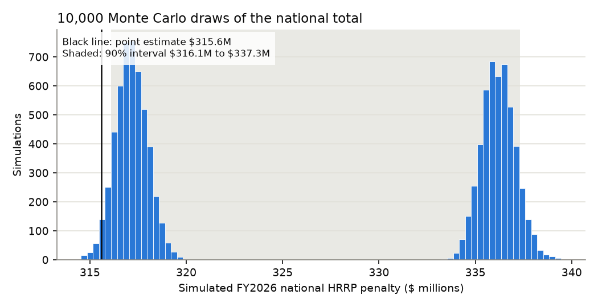
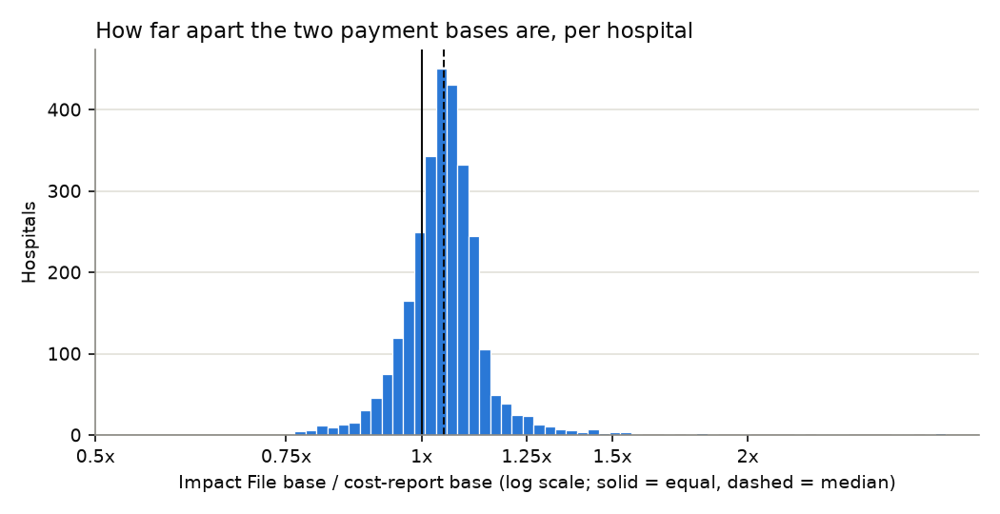

# How sure is the penalty estimate? Payment-base cross-check and a 90% interval

_Generated 2026-11-04 02:24 UTC by `python -m analysis.penalty_uncertainty` (10,000 draws, seed 2026). Method: `hrrp/uncertainty.py`._

## Headline

National FY2026 HRRP penalty: point estimate **$315.6M** (2,900 hospitals with a usable cost-report base).

- **Same hospitals as the point estimate:** 90% interval $314.6M to $335.7M. Every interval over these hospitals contains its point estimate (national, conditions, chains).
- **All penalized hospitals:** 90% interval **$316.1M to $337.3M** (mean $326.6M; the median is not quoted because the draws have two modes, one per payment-base source, and the median jumps between them). This adds the {len(pen_missing)} hospitals CMS penalized that have no usable cost-report base (alone they add $1.4M to $3.4M), so its low end can sit above the point estimate: the point estimate leaves those hospitals at $0.
- **Direction:** across hospitals with both bases, the Impact File total is 1.051x the cost-report total (section 1), so the published point estimate is more likely low than high.

## 1. Cost report vs Impact File: the gap in each hospital's base

**Cost-report base:** HCRIS Worksheet E Part A line 1, latest report, annualised (penalty_method.md). **Impact File base:** CMS's FY2026 IPPS Impact File, transfer-adjusted cases x transfer-adjusted case-mix index x (labor standardized amount x FY2026 wage index + nonlabor amount x COLA), with the FY2026 national standardized amounts from the final rule:

Table 1A (wage index > 1): labor $4,456.72, nonlabor $2,295.89 (66.0% labor share). Table 1B (wage index <= 1): labor $4,186.62, nonlabor $2,565.99 (62.0%). Read from `2025-14681.htm`; the text the parser matched is quoted at the end of this report.

Impact File columns used (matched by pattern in `ingest/load.py`; check these are the right ones):

| field | matched_column |
|---|---|
| bills | Bills |
| case_mix_index | TACMIV43 |
| ccn | Provider Number |
| cola | Cost of Living Adjustment |
| readmissions_adjustment_factor | Proxy Readmission Adjustment Factor |
| transfer_adjusted_cases | CASETA43 |
| wage_index | FY 2026 Wage Index |

CCN join check. The Impact File carries a *proxy* readmissions factor (CMS's estimate when it built the file), so not every hospital has to match the final factor; a high match rate shows the CCNs line up:

| hospitals_with_cms_factor | found_in_impact_file | impact_file_hrrp_factor_present | factor_matches_supplemental_file (within 0.0001) |
|---|---|---|---|
| 2937 | 2928 | 2928 | 612 |

Gap = Impact File base / cost-report base (1.0 = the two agree):

| group | hospitals | p5 | p25 | p50 | p75 | p95 | share_within_10pct | share_within_25pct | total_ratio (sum IF / sum CR) |
|---|---|---|---|---|---|---|---|---|---|
| All hospitals with both bases | 2897 | 0.917 | 1.004 | 1.049 | 1.093 | 1.207 | 74.6% | 96.0% | 1.051 |
| Quality: ok but annualised: partial-year cost report | 54 | 0.797 | 0.981 | 1.071 | 1.116 | 1.316 | 50.0% | 87.0% | 1.060 |
| Quality: ok: full-year cost report | 2843 | 0.918 | 1.004 | 1.049 | 1.092 | 1.205 | 75.1% | 96.2% | 1.051 |
| System: Community Health Systems | 49 | 0.989 | 1.033 | 1.084 | 1.122 | 1.163 | 61.2% | 100.0% | 1.079 |
| System: HCA Healthcare | 144 | 0.942 | 1.017 | 1.060 | 1.101 | 1.415 | 73.6% | 92.4% | 1.092 |
| System: Not one of the four chains | 2623 | 0.913 | 1.004 | 1.048 | 1.091 | 1.201 | 75.2% | 96.3% | 1.048 |
| System: Tenet Healthcare | 59 | 0.912 | 1.000 | 1.058 | 1.119 | 1.275 | 64.4% | 89.8% | 1.117 |
| System: Universal Health Services | 22 | 0.950 | 0.979 | 1.050 | 1.097 | 1.136 | 72.7% | 100.0% | 1.036 |
| Beds (3.999, 49.0] | 632 | 0.855 | 1.000 | 1.053 | 1.115 | 1.274 | 63.0% | 92.1% | 1.056 |
| Beds (49.0, 108.0] | 533 | 0.916 | 1.008 | 1.052 | 1.093 | 1.197 | 75.0% | 97.2% | 1.045 |
| Beds (108.0, 183.0] | 578 | 0.930 | 1.004 | 1.044 | 1.085 | 1.174 | 79.2% | 97.6% | 1.038 |
| Beds (183.0, 319.0] | 579 | 0.939 | 1.003 | 1.047 | 1.088 | 1.154 | 78.2% | 97.4% | 1.051 |
| Beds (319.0, 2863.0] | 575 | 0.932 | 1.009 | 1.049 | 1.088 | 1.169 | 78.8% | 96.3% | 1.055 |

All percentiles and shares: `analysis/output/impact_gap_summary.csv`; every hospital: `analysis/output/impact_gap_by_hospital.csv`.

Penalty totals under each base:

| base | hospitals | total_usd |
|---|---|---|
| Cost report (published point estimate) | 2900 | $315.6M |
| Impact File, same hospitals where available | 2897 | $334.6M |
| Cost report, same hospitals | 2897 | $315.6M |

## 2. Monte Carlo

Two inputs go into the interval (DRG ratios are a separate sensitivity, below). Every distribution is resampled from observed data:

| Input | What is drawn | Where the distribution comes from |
|---|---|---|
| Payment base, level | Each draw uses the cost-report level or the Impact File level, 50/50 | The two sources differ systematically (different years and rates) and neither is FY2026 actuals, so the choice moves every hospital together. 50/50 is a CHOICE: no data says which source is closer. |
| Payment base, hospital noise | Each hospital's base x exp(e), e resampled per hospital | Observed log gaps ln(Impact/cost report) for 2,839 hospitals, divided by sqrt(2) and shifted so the average multiplier is 1 (equal noise in each source). Gaps outside the 1st-99th percentile (0.81x to 1.69x) are left out of the pool as likely data errors. |
| Penalized hospitals with no usable base (23) | A base for each | The other source's base x a resampled gap; with neither source, the base of a random hospital in the same bed-size fifth. |

### DRG payment ratios: a sensitivity, not part of the interval

The ratios only split each hospital's dollars across conditions (CMS's factor is fixed). We measured how much each hospital's ratio changed between CMS's FY2023 and FY2026 files and re-ran the split with that drift resampled. Because shares are renormalised, the result depends on how the noise is centred: median-centred noise pushes noisy conditions up, mean-1 noise pushes them down, by similar amounts. A result that flips with a convention is not something the data pins down, so the drift is shown here and kept out of the 90% intervals, whose condition split is CMS's own arithmetic.

Observed drift in DRG payment ratios (FY2026 ratio / earlier ratio):

| condition | hospitals | ratio_change_p5 | median (trend, not applied) | p95 | trimmed_below | trimmed_above |
|---|---|---|---|---|---|---|
| ami | 2487 | 0.401 | 0.895 | 2.134 | 0.189 | 4.953 |
| hf | 2721 | 0.695 | 0.992 | 1.413 | 0.453 | 2.223 |
| copd | 2710 | 0.439 | 0.742 | 1.266 | 0.266 | 2.083 |
| cabg | 981 | 0.526 | 0.980 | 1.664 | 0.130 | 2.927 |
| tha_tka | 2417 | 0.069 | 0.336 | 1.208 | 0.023 | 2.949 |

Condition totals with the drift resampled, base held at the cost report (5th to 95th percentile):

| condition | point_estimate_usd | median-centred: p5 | median-centred: p95 | mean-1: p5 | mean-1: p95 |
|---|---|---|---|---|---|
| AMI | $46.1M | $45.5M | $48.8M | $43.6M | $46.8M |
| Heart failure | $72.3M | $70.5M | $72.9M | $72.2M | $74.6M |
| Pneumonia | $103.1M | $100.7M | $103.0M | $104.4M | $106.7M |
| COPD | $15.7M | $15.6M | $16.6M | $15.7M | $16.7M |
| CABG | $40.1M | $38.3M | $40.8M | $39.0M | $41.6M |
| Hip/knee | $38.3M | $37.7M | $41.0M | $33.5M | $36.6M |

### National, by condition, by chain

| name | point_estimate_usd | 90% interval, same hospitals | contains point | 90% interval, all penalized hospitals | mean, all penalized |
|---|---|---|---|---|---|
| national | $315.6M | $314.6M to $335.7M | True | $316.1M to $337.3M | $326.6M |
| AMI | $46.1M | $45.9M to $49.4M | True | $46.1M to $49.6M | $47.8M |
| Heart failure | $72.3M | $72.0M to $76.4M | True | $72.5M to $76.9M | $74.7M |
| Pneumonia | $103.1M | $102.7M to $109.3M | True | $103.1M to $109.7M | $106.4M |
| COPD | $15.7M | $15.6M to $16.7M | True | $15.7M to $16.7M | $16.2M |
| CABG | $40.1M | $39.8M to $43.4M | True | $40.0M to $43.6M | $41.7M |
| Hip/knee | $38.3M | $38.1M to $41.0M | True | $38.4M to $41.3M | $39.8M |
| HCA Healthcare | $26.1M | $25.9M to $29.1M | True | $25.9M to $29.1M | $27.5M |
| Tenet Healthcare | $4.9M | $4.8M to $5.8M | True | $4.8M to $5.8M | $5.3M |
| Community Health Systems | $4.4M | $4.3M to $4.9M | True | $4.3M to $4.9M | $4.6M |
| Universal Health Services | $3.0M | $2.9M to $3.2M | True | $2.9M to $3.2M | $3.1M |

### Which input drives the width (national total, one input varied at a time)

| inputs varied | p5_usd | p95_usd | width_usd |
|---|---|---|---|
| Both inputs | $316.1M | $337.3M | $21.2M |
| Payment base only | $314.6M | $335.7M | $21.1M |
| Penalized hospitals with no base only | $317.0M | $319.0M | $2.0M |

## What this does not cover

- Hospitals with no CMS factor (Maryland and others not in the payment file) are left out, as in the point estimate: CMS gave them no penalty to estimate.
- Sole community and Medicare-dependent hospitals can be paid on a hospital-specific rate; the Impact File base uses the federal rate for everyone.
- The Impact File uses FY2024 claim volume. If FY2026 Medicare fee-for-service volume differs (for example, more Medicare Advantage enrolment), both sources miss it in the same direction.

## Rule text the standardized amounts were read from

> Table 1A--National Adjusted Operating Standardized Amounts, Labor/Nonlabor (66.0 Percent Labor Share/34.0 Percent Nonlabor Share if Wage Index Is Greater Than 1)--FY 2026 Final Rule -------------------------------------------------------------------------------------------------------------------------------------------------------- Hospital submitted quality data and is Hospital submitted quality data and Hospital did NOT submit quality data Hospital did NOT submit quality data a meaningful EHR user (update = 2.6 is NOT a meaningful EHR user (update and is a meaningful EHR user (update and is NOT a meaningful EHR user percent) = 0.125 percent) = 1.775 percent) (update = -0.7 percent) ------

> Table 1B--National Adjusted Operating Standardized Amounts, Labor/Nonlabor (62 Percent Labor Share/38 Percent Nonlabor Share if Wage Index Is Less Than or Equal to 1)--FY 2026 Final Rule -------------------------------------------------------------------------------------------------------------------------------------------------------- Hospital submitted quality data and is Hospital submitted quality data and Hospital did NOT submit quality data Hospital did NOT submit quality data a meaningful EHR user (update = 2.6 is NOT a meaningful EHR user (update and is a meaningful EHR user (update and is NOT a meaningful EHR user percent) = 0.125 percent) = 1.775 percent) (update = -0.7 percent) -

