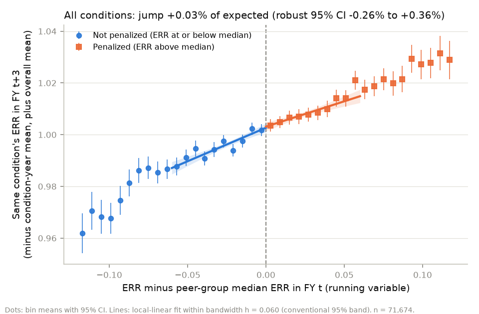
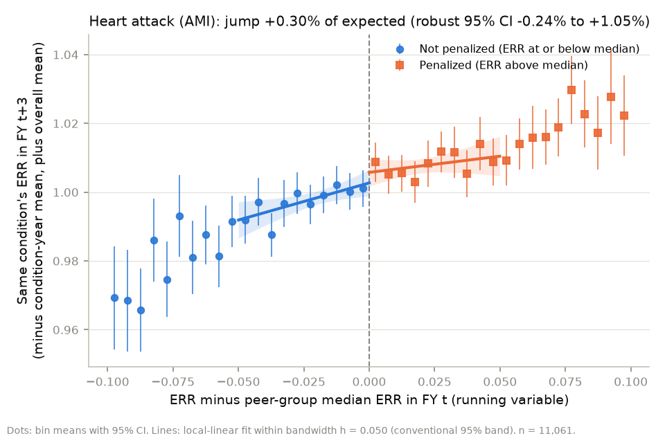
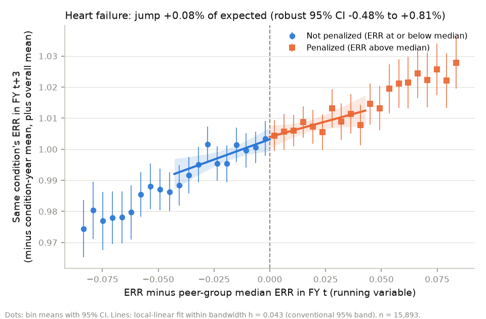
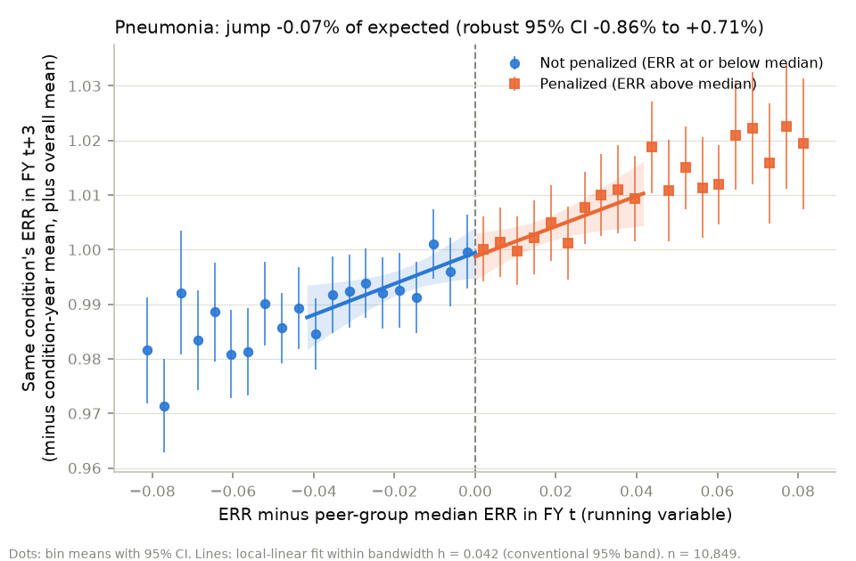
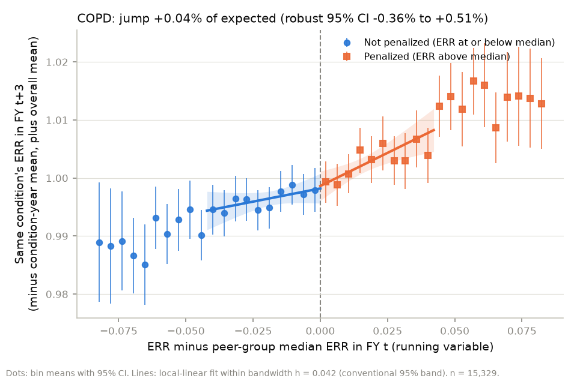
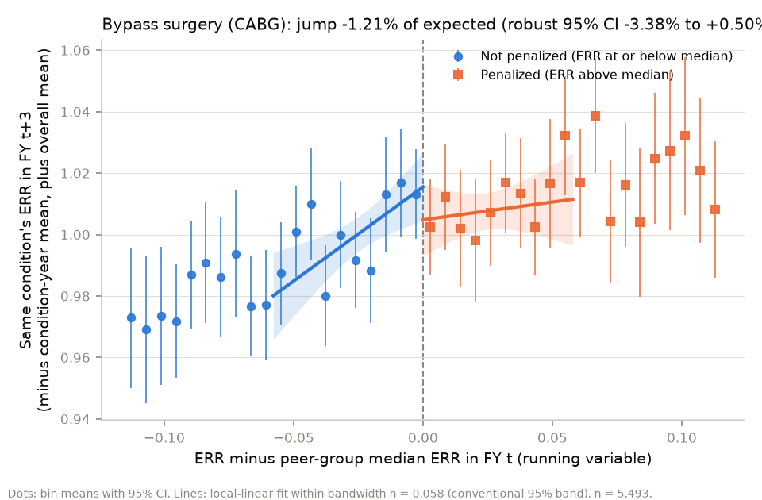
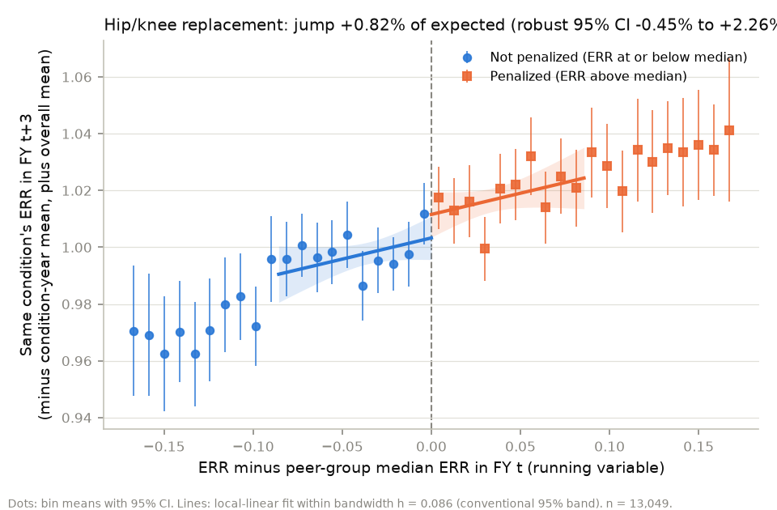

# Does a readmission penalty lower that condition's later readmissions?

_Generated 2026-11-04 01:12 UTC by `python -m analysis.rd_report` from `mart.fct_hospital_condition_year` (payment years up to FY2027). Do not edit by hand; every number below comes from that run._

## Bottom line

Being just above the peer-group median (penalized) rather than just below it is followed, 3 payment years later, by readmissions 0.03% of expected higher for the same condition (robust 95% CI -0.26% to +0.36%). The 95% interval includes zero, so the data can't tell this apart from no effect.

- **Who this applies to:** hospital-condition-years with 25+ eligible discharges whose ERR in FY t was within 0.060 of their peer-group median (43,879 of 71,674 rows, 61%), in treatment years FY2019-FY2024. It is the effect of being *just* over the median versus *just* under it, not the effect of the penalty on all hospitals, and not the effect on hospitals far above the median (who pay the most).
- **Units:** ERR is predicted / expected readmissions, so a jump of -0.01 in ERR means readmissions 1% of expected lower.
- **Design:** sharp RD (see *Sharp or fuzzy* below), local-linear, triangular kernel, MSE-optimal bandwidth, robust bias-corrected CI (rdrobust), condition x year fixed effects as covariates, standard errors clustered by hospital.

**What it can't rule out**

- *It is the effect of crossing the line once, not of one year's penalty.* A hospital just above the median in FY t is also more likely to be above it in FY t+1 and t+2 (their periods overlap), so the estimate bundles in those later penalties too (an intent-to-treat effect of FY t's status).
- *Timing.* The FY t+3 window starts before the hospital sees its FY t result (see *Timing* below); the FY t+4 row is the check on that. Hospitals also track their own readmissions all along, so 'being near the line' may matter more than the formal notice.
- *Effects away from the median.* Hospitals far above the median face larger penalties and may respond more (or less); RD says nothing about them.
- *Spillovers.* A hospital penalized on one condition may improve care for all conditions, including ones where it was just below the median; that would bias the jump toward zero.
- *Who stays.* If penalized hospitals were more likely to close, merge or lose 25+ cases, the outcome sample would differ at the cutoff; the attrition row in *Balance* checks this.
- *Six conditions, many checks.* Some per-condition or placebo results will be 'significant' by chance.

## Sharp or fuzzy?

CMS counts a condition toward the penalty only if its ERR is **above** the peer-group median **and** it had at least 25 eligible discharges. So on all rows, crossing the median does not always switch the penalty on (fuzzy); among rows with 25+ discharges it should (sharp). Penalized share by side, from CMS's indicator (`penalized_condition`):

| meets_min | side | rows | penalized | share_penalized |
|---|---|---|---|---|
| False | above median | 6,439 | 0 | 0 |
| False | at or below median | 6,842 | 0 | 0 |
| True | above median | 38,583 | 38,583 | 1 |
| True | at or below median | 38,180 | 0 | 0 |

Rows exactly at the median (x = 0, not penalized under 'above'; rdrobust would count them as treated): **102**, dropped. Estimation sample (25+ cases, outcome observed): **sharp**. All rows: **fuzzy**; its fuzzy RD is in *Robustness*.

## Timing: do the windows overlap?

Performance periods from the panel (`perf_start`, `perf_end`). The running variable uses FY t's window; the outcome uses FY t+h's. CMS sends each hospital its FY t result (Hospital-Specific Report) in the summer before FY t starts on October 1 (for FY2024: the HSR webinar of 17 August 2023, https://qualityreportingcenter.com/globalassets/iqr-2023-events/vbp081723/fy-2024-hrrp-hsr-webinar508_.pdf). Compare that with when the FY t+h window starts: part of a window can come before the hospital knew its FY t result.

| horizon | fy_t | fy_t_h | period_t | period_t_h | overlap_months |
|---|---|---|---|---|---|
| 3 | 2019 | 2022 | 2014-07..2017-06 | 2017-07..2019-12 | 0 |
| 3 | 2020 | 2023 | 2015-07..2018-06 | 2018-07..2021-06 | 0 |
| 3 | 2021 | 2024 | 2016-07..2019-06 | 2019-07..2022-06 | 0 |
| 3 | 2022 | 2025 | 2017-07..2019-12 | 2020-07..2023-06 | 0 |
| 3 | 2023 | 2026 | 2018-07..2021-06 | 2021-07..2024-06 | 0 |
| 3 | 2024 | 2027 | 2019-07..2022-06 | 2023-07..2025-06 | 0 |
| 1 | 2019 | 2020 | 2014-07..2017-06 | 2015-07..2018-06 | 24 |
| 1 | 2020 | 2021 | 2015-07..2018-06 | 2016-07..2019-06 | 24 |
| 1 | 2021 | 2022 | 2016-07..2019-06 | 2017-07..2019-12 | 24 |
| 1 | 2022 | 2023 | 2017-07..2019-12 | 2018-07..2021-06 | 17 |
| 1 | 2023 | 2024 | 2018-07..2021-06 | 2019-07..2022-06 | 24 |
| 1 | 2024 | 2025 | 2019-07..2022-06 | 2020-07..2023-06 | 24 |
| 1 | 2025 | 2026 | 2020-07..2023-06 | 2021-07..2024-06 | 24 |
| 1 | 2026 | 2027 | 2021-07..2024-06 | 2023-07..2025-06 | 12 |
| 4 | 2019 | 2023 | 2014-07..2017-06 | 2018-07..2021-06 | 0 |
| 4 | 2020 | 2024 | 2015-07..2018-06 | 2019-07..2022-06 | 0 |
| 4 | 2021 | 2025 | 2016-07..2019-06 | 2020-07..2023-06 | 0 |
| 4 | 2022 | 2026 | 2017-07..2019-12 | 2021-07..2024-06 | 0 |
| 4 | 2023 | 2027 | 2018-07..2021-06 | 2023-07..2025-06 | 0 |

## Estimates

### Outcome: ERR in FY t+3 (main (non-overlapping window))

| | Jump (ERR) | % of expected | Robust 95% CI | p (robust) | h | n in h (below / above) | n | Hospitals |
|---|---|---|---|---|---|---|---|---|
| All conditions | +0.0003 | +0.03% | -0.26% to +0.36% | 0.744 | 0.0601 | 22,726 / 21,153 | 71,674 | 3,002 |
| Heart attack (AMI) | +0.0030 | +0.30% | -0.24% to +1.05% | 0.222 | 0.0499 | 3,283 / 3,197 | 11,061 | 2,077 |
| Heart failure | +0.0008 | +0.08% | -0.48% to +0.81% | 0.614 | 0.0428 | 3,928 / 3,815 | 15,893 | 2,815 |
| Pneumonia | -0.0007 | -0.07% | -0.86% to +0.71% | 0.846 | 0.0417 | 2,814 / 2,503 | 10,849 | 2,854 |
| COPD | +0.0004 | +0.04% | -0.36% to +0.51% | 0.744 | 0.0422 | 4,918 / 4,499 | 15,329 | 2,770 |
| Bypass surgery (CABG) | -0.0121 | -1.21% | -3.38% to +0.50% | 0.146 | 0.0579 | 1,215 / 1,147 | 5,493 | 1,006 |
| Hip/knee replacement | +0.0082 | +0.82% | -0.45% to +2.26% | 0.189 | 0.0857 | 3,702 / 3,293 | 13,049 | 2,462 |

### Outcome: ERR in FY t+1 (contaminated by overlap)

**Contaminated by overlap:** FY t+1's three-year window shares most of its discharges with FY t's, so this partly measures the same readmissions that put the hospital over the line. Shown for comparison only; do not read it as an effect.

| | Jump (ERR) | % of expected | Robust 95% CI | p (robust) | h | n in h (below / above) | n | Hospitals |
|---|---|---|---|---|---|---|---|---|
| All conditions | +0.0002 | +0.02% | -0.13% to +0.23% | 0.571 | 0.0510 | 27,607 / 25,579 | 96,319 | 3,120 |
| Heart attack (AMI) | +0.0007 | +0.07% | -0.36% to +0.54% | 0.695 | 0.0455 | 4,019 / 3,930 | 14,620 | 2,139 |
| Heart failure | +0.0006 | +0.06% | -0.26% to +0.43% | 0.638 | 0.0541 | 6,581 / 6,268 | 21,391 | 2,913 |
| Pneumonia | +0.0001 | +0.01% | -0.35% to +0.45% | 0.809 | 0.0525 | 5,219 / 4,539 | 16,473 | 2,969 |
| COPD | +0.0002 | +0.02% | -0.28% to +0.33% | 0.880 | 0.0356 | 5,804 / 5,212 | 20,196 | 2,862 |
| Bypass surgery (CABG) | -0.0059 | -0.59% | -1.66% to +0.44% | 0.253 | 0.0757 | 2,143 / 1,995 | 7,323 | 1,035 |
| Hip/knee replacement | +0.0005 | +0.05% | -0.67% to +0.89% | 0.781 | 0.0964 | 4,949 / 4,411 | 16,316 | 2,526 |

### Outcome: ERR in FY t+4 (timing check)

| | Jump (ERR) | % of expected | Robust 95% CI | p (robust) | h | n in h (below / above) | n | Hospitals |
|---|---|---|---|---|---|---|---|---|
| All conditions | +0.0006 | +0.06% | -0.28% to +0.43% | 0.674 | 0.0590 | 18,384 / 17,113 | 59,379 | 2,952 |
| Heart attack (AMI) | +0.0010 | +0.10% | -0.67% to +0.84% | 0.819 | 0.0494 | 2,747 / 2,684 | 9,346 | 2,056 |
| Heart failure | +0.0028 | +0.28% | -0.37% to +1.15% | 0.313 | 0.0393 | 3,011 / 2,921 | 13,220 | 2,774 |
| Pneumonia | -0.0040 | -0.40% | -1.59% to +0.51% | 0.316 | 0.0323 | 1,680 / 1,488 | 8,141 | 2,782 |
| COPD | +0.0013 | +0.13% | -0.33% to +0.61% | 0.554 | 0.0411 | 4,019 / 3,702 | 12,968 | 2,739 |
| Bypass surgery (CABG) | -0.0058 | -0.58% | -2.77% to +1.26% | 0.462 | 0.0796 | 1,310 / 1,176 | 4,582 | 993 |
| Hip/knee replacement | +0.0054 | +0.54% | -0.86% to +2.14% | 0.403 | 0.0898 | 3,199 / 2,901 | 11,122 | 2,428 |

## Validity checks (outcome FY t+3)

### Density of the running variable at the cutoff (rddensity)

If hospitals could steer their ERR to just under the median, there would be a pile-up just below 0. A large p-value means no evidence of that. (No clustering: a hospital counts once per condition-year.)

| label | t_jackknife | p_jackknife | h_left | h_right | n_left | n_right | n_eff_left | n_eff_right | error |
|---|---|---|---|---|---|---|---|---|---|
| All conditions | 0.09854 | 0.9215 | 0.02054 | 0.02739 | 35,619 | 36,055 | 8,977 | 11,238 |  |
| Heart attack (AMI) | 0.4147 | 0.6784 | 0.03187 | 0.03266 | 5,326 | 5,735 | 2,260 | 2,239 |  |
| Heart failure | -0.09351 | 0.9255 | 0.0222 | 0.03032 | 7,938 | 7,955 | 2,102 | 2,862 |  |
| Pneumonia | -0.7429 | 0.4575 | 0.03074 | 0.03285 | 5,455 | 5,394 | 2,171 | 2,055 |  |
| COPD | 0.2194 | 0.8263 | 0.02315 | 0.02461 | 7,634 | 7,695 | 2,969 | 2,906 |  |
| Bypass surgery (CABG) | -1.256 | 0.2089 | 0.04247 | 0.0588 | 2,766 | 2,727 | 907 | 1,163 |  |
| Hip/knee replacement | 1.154 | 0.2485 | 0.0476 | 0.05245 | 6,500 | 6,549 | 2,110 | 2,186 |  |

### Covariate balance at the cutoff

Each row is an RD with a predetermined characteristic as the 'outcome': it should not jump. Beds, ownership and teaching are one FY2026 snapshot per hospital (General Info / cost report).

| | Jump |  | Robust 95% CI | p (robust) | h | n in h (below / above) | n | Hospitals |
|---|---|---|---|---|---|---|---|---|
| Beds (cost report) | -3.4755 |  | -23.4616 to 11.1401 | 0.485 | 0.0428 | 17,058 / 16,118 | 70,078 | 2,835 |
| Dual-eligible share (CMS, FY t) | +0.0003 |  | -0.0087 to 0.0097 | 0.911 | 0.0552 | 21,407 / 19,940 | 71,674 | 3,002 |
| For-profit (0/1) | -0.0034 |  | -0.0307 to 0.0224 | 0.760 | 0.0874 | 27,392 / 25,999 | 69,973 | 2,828 |
| Government-owned (0/1) | +0.0053 |  | -0.0183 to 0.0314 | 0.605 | 0.0551 | 20,737 / 19,408 | 69,973 | 2,828 |
| Teaching (0/1, residents > 0) | -0.0090 |  | -0.0507 to 0.0242 | 0.488 | 0.0464 | 18,237 / 17,173 | 70,092 | 2,836 |
| Same condition's ERR in FY t-3 (pre-period) | +0.0012 |  | -0.0023 to 0.0056 | 0.409 | 0.0496 | 19,266 / 18,013 | 69,907 | 2,973 |
| Outcome observed in FY t+3 (attrition, 0/1) | +0.0055 |  | -0.0033 to 0.0153 | 0.206 | 0.0644 | 25,647 / 23,822 | 76,763 | 3,136 |

Mean just below the cutoff (within h), for scale: Beds (cost report): 232; Dual-eligible share (CMS, FY t): 0.233; For-profit (0/1): 0.166; Government-owned (0/1): 0.144; Teaching (0/1, residents > 0): 0.494; Same condition's ERR in FY t-3 (pre-period): 0.993; Outcome observed in FY t+3 (attrition, 0/1): 0.928.

### Robustness: placebo cutoffs, donut, bandwidth, fuzzy on all rows

Placebo cutoffs use only one side of the real cutoff, where nothing changes, so they should show no jump. The donut drops the hospitals closest to the median. Half and double bandwidth scale both h and the bias bandwidth b.

| | Jump (ERR) | % of expected | Robust 95% CI | p (robust) | h | n in h (below / above) | n | Hospitals |
|---|---|---|---|---|---|---|---|---|
| All rows incl. <25 cases (fuzzy RD) | +0.0005 | +0.05% | -0.28% to +0.49% | 0.588 | 0.0406 | 21,757 / 19,908 | 82,072 | 3,084 |
| Donut: drop abs(x) < 0.002 | -0.0000 | -0.00% | -0.31% to +0.38% | 0.842 | 0.0549 | 20,463 / 19,011 | 69,929 | 2,999 |
| Bandwidth x 0.5 | +0.0000 | +0.00% | -0.40% to +0.40% | 1.000 | 0.0300 | 12,902 / 12,196 | 71,674 | 3,002 |
| Bandwidth x 2 | -0.0005 | -0.05% | -0.18% to +0.34% | 0.552 | 0.1201 | 31,818 / 30,552 | 71,674 | 3,002 |
| Placebo cutoff at -0.05 | +0.0014 | +0.14% | -0.55% to +0.80% | 0.716 | 0.0189 | 4,913 / 6,584 | 35,619 | 2,951 |
| Placebo cutoff at +0.05 | -0.0006 | -0.06% | -0.80% to +0.49% | 0.639 | 0.0205 | 6,560 / 5,008 | 36,055 | 2,885 |

## Figures

### All conditions

### Heart attack (AMI)

### Heart failure

### Pneumonia

### COPD

### Bypass surgery (CABG)

### Hip/knee replacement

## Files

- `analysis/output/rd_estimates.csv`: every estimate above, one row each
- `analysis/output/rd_density.csv`, `rd_compliance.csv`, `rd_overlap.csv`
- Method: `hrrp/causal/rd.py` (tests in `tests/test_rd.py`)
